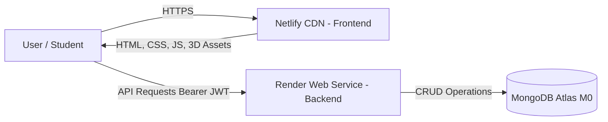

# 🚀 AccessibleVerse Deployment Guide — Netlify & Render

This guide provides end-to-end instructions for deploying:
- **Backend (Python Flask REST API + MongoDB)** to **[Render](https://render.com/)**
- **Frontend (Accessible Web App & 3D Interactive Worlds)** to **[Netlify](https://www.netlify.com/)**

---

## 🏗️ Architecture Overview



---

## 1️⃣ Part 1: Deploy Backend to Render

> **Tip:** Deploy the backend first so you obtain your live Render backend URL.

### Option A: Render Blueprint (1-Click Automated Setup)

The repository includes a ready-to-use [`render.yaml`](render.yaml) file.

1. Sign up or log in at **[dashboard.render.com](https://dashboard.render.com/)**.
2. Click **New +** in the top navigation bar and select **Blueprint**.
3. Connect your GitHub repository:
   `https://github.com/tejasm103/computer-based-learning-tool-for-mentally-challenged-student`
4. Render will detect `render.yaml` automatically.
5. In the configuration screen, Render will prompt you for:
   - **`MONGODB_URI`**: Paste your full MongoDB Atlas connection string:
     `mongodb+srv://<username>:<password>@cluster0.3neibjf.mongodb.net/?retryWrites=true&w=majority`
     *(Ensure `<password>` is replaced with your real database password).*
6. Click **Apply**. Render will install dependencies and start the service with Gunicorn.

---

### Option B: Manual Web Service Setup on Render

If you prefer configuring the service manually:

1. In the **Render Dashboard**, click **New +** → **Web Service**.
2. Choose **Build and deploy from a Git repository** and connect your GitHub repo.
3. Configure the settings:
   | Setting | Value |
   | :--- | :--- |
   | **Name** | `accessibleverse-backend` |
   | **Region** | Oregon (US West) or Ohio / Frankfurt |
   | **Branch** | `main` |
   | **Root Directory** | `backend` |
   | **Runtime** | `Python 3` |
   | **Build Command** | `pip install -r requirements.txt` |
   | **Start Command** | `gunicorn --bind 0.0.0.0:$PORT run:app` |
   | **Instance Type** | `Free` |

4. Scroll down to **Environment Variables** and add:
   | Key | Value | Description |
   | :--- | :--- | :--- |
   | `PYTHON_VERSION` | `3.11.9` | Ensures compatible Python environment |
   | `FLASK_ENV` | `production` | Production mode |
   | `PORT` | `5000` | Internal port |
   | `JWT_SECRET_KEY` | *(Click "Generate" or enter random string)* | Used to sign auth JWTs |
   | `MONGODB_URI` | `mongodb+srv://<username>:<password>@cluster...` | Your MongoDB Atlas connection string |
   | `MONGODB_DB_NAME` | `accessibleverse` | Target database name |
   | `FRONTEND_ORIGIN` | `*` | Allows Netlify domains (or set to your netlify URL) |

5. Under **Advanced**, set **Health Check Path** to `/api/health`.
6. Click **Create Web Service**.

---

### Verify Your Render Backend

Once Render finishes building:
1. Copy your service URL (e.g., `https://accessibleverse-backend.onrender.com`).
2. Visit `https://accessibleverse-backend.onrender.com/api/health` in your browser.
3. You should see a JSON response:
   ```json
   {
     "status": "healthy",
     "service": "AccessibleVerse Backend REST API",
     "database": {
       "connected": true,
       "engine": "MongoDB Atlas"
     }
   }
   ```
   *(Note: On Render's Free tier, services sleep after 15 minutes of inactivity and take ~30-50 seconds to wake up on the first request).*

---

## 2️⃣ Part 2: Configure MongoDB Atlas Network Access

MongoDB Atlas requires your database cluster to accept connections from Render's dynamic IP addresses:

1. Open **[cloud.mongodb.com](https://cloud.mongodb.com/)**.
2. In the left navigation, click **Network Access** (under Security).
3. Check your IP Access List:
   - If not already present, click **Add IP Address**.
   - Select **Allow Access From Anywhere (`0.0.0.0/0`)**.
   - Click **Confirm**.

---

## 3️⃣ Part 3: Deploy Frontend to Netlify

The repository is pre-configured with [`netlify.toml`](netlify.toml) and [`frontend/_redirects`](frontend/_redirects) for static routing and security headers.

### Option A: Connect via GitHub (Automatic Continuous Deployment)

1. Sign up or log in at **[app.netlify.com](https://app.netlify.com/)**.
2. Click **Add new site** → **Import an existing project**.
3. Select **GitHub** and authorize access.
4. Select the repository:
   `computer-based-learning-tool-for-mentally-challenged-student`
5. Configure the site settings:
   - **Branch to deploy**: `main`
   - **Base directory**: `frontend` (or leave empty)
   - **Build command**: *(leave blank — static web app)*
   - **Publish directory**: `frontend` (if base directory is blank) or `.` (if base directory is `frontend`)
6. Click **Deploy AccessibleVerse**.
7. Netlify will deploy your site in ~10 seconds and generate an HTTPS URL (e.g., `https://accessibleverse-explore.netlify.app`).

---

### Option B: Netlify Drop (Instant Manual Drag-and-Drop)

1. Open **[app.netlify.com/drop](https://app.netlify.com/drop)** in your browser.
2. Drag and drop the `frontend` folder from your local workspace (`d:\app\frontend`) onto the page.
3. Netlify will immediately publish your website!

---

## 4️⃣ Part 4: Connect Frontend to Your Live Render Backend

There are three ways to point your Netlify frontend to your live Render backend:

### Method 1: Using the In-App Settings UI (No Code Changes Needed!)
1. Open your published Netlify URL (e.g. `https://your-site.netlify.app/profile.html`).
2. Go to **Profile** (or click the User avatar).
3. Scroll down to **Backend API Connection (Render / Local)**.
4. Paste your live Render URL into the input field:
   `https://your-service-name.onrender.com`
5. Click **Test & Connect**. The badge will turn **🟢 Connected**!
6. The URL is saved in `localStorage`, so your browser will remember it.

### Method 2: Via Browser Console
Open DevTools (`F12`) on your Netlify site and run:
```javascript
window.setBackendUrl("https://accessibleverse-backend.onrender.com");
```

### Method 3: Defaulting in Code
Edit [`frontend/js/config.js`](frontend/js/config.js#L44):
```javascript
// Replace with your actual Render service URL:
return 'https://your-service-name.onrender.com';
```
Commit and push to `main` — Netlify will automatically redeploy!

---

## 🛡️ Offline & Sleep Resilience

- **Render Free Tier Spin-Down**: If the Render backend goes to sleep, the frontend will automatically use local storage and offline lessons/games until the backend finishes waking up.
- **CORS Handling**: `backend/app/__init__.py` automatically permits all `https://*.netlify.app` deployment URLs and previews, eliminating CORS blockers.
